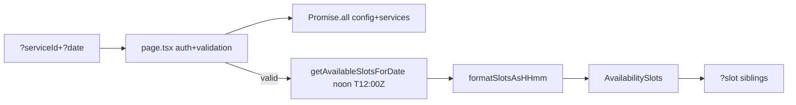

# Proposal: T-042 Mostrar disponibilidad

## Intent

Show only filtered `HH:mm` for validated `?serviceId=` + `?date=` BA (duration, `fechaHoraFin <= finIntervaloOperativo`, `count < capacityPerSlot`, closed `[]`). No booking — T-043. Bridges T-041 → T-043.

## Scope

### In Scope
- RSC `availableSlots: string[]` when `selectedService && selectedDate` (server-direct).
- Compound `AvailabilitySlots` grid; `?slot=HH:mm` sibling-preserving.
- States: `null` hint, `[]` EC-02, closed vs booked, tampered no 500.
- CSS tokens + `loading`/`error` reuse.

### Out of Scope
- T-043 form/`POST`, T-044 banner. No new API (reuse T-025).

## Capabilities

### New Capabilities
- `availability-display`: displays filtered slots; writes `?slot=HH:mm`.

### Modified Capabilities
- None.

## Approach

**A+C1** per explore #452 (RSC server-direct + button-grid).

- Keep `dynamic="force-dynamic" revalidate=0`; parallel `config+services` unchanged; fetch only when guards pass.
- Mirrors `route.ts:96-121`: `noonDate=new Date("${selectedDate}T12:00:00.000Z")`, `fetchActiveTurnos:(r)=>findActiveTurnosByDateRange(db,r)`, `formatSlotsAsHHmm(slots,config.timezone)`. Only `string[]` crosses (INV-06 `TIMESTAMPTZ`/`Intl en-CA` §6.3.1 §8.5).
- Tampered `?serviceId` (inactive/non-UUID) → CTA no fetch. Tampered `?date` (overflow/past/>max) → hint no fetch. Closed → `[]`.
- Compound reuses `DateSelector`: `createContext` + `useSearchParams` + `URLSearchParams` + `router.push({scroll:false})`; `includes` guard.

## Affected Areas

| Area | Impact | Description |
|------|--------|-------------|
| `src/app/(customer)/appointments/new/page.tsx` | Modified | Conditional fetch + threading |
| `_components/AvailabilitySlots.tsx` | New | Compound Grid/Empty/Banner `radiogroup` |
| `appointments.module.css` | Modified | `.slotGrid/.slotButton/.slotSelected` |
| `services/availability/*`, `config/workshop*`, `db/repositories/turnos.ts` | Read-only | DI `capacityPerSlot=1` `slotStep=30` |
| `loading.tsx`+`error.tsx` | Read-only | Boundary wraps page |

## Risks

| Risk | Likelihood | Mitigation |
|------|------------|------------|
| BA drift | High | RSC truth; client never `new Date()` BA |
| Closed vs error | High | Empty closed vs EC-02 booked |
| Hardcode drift | Med | `getWorkshopConfig(db)` per-request |
| Overrun | Med | Single RSC fetch, sync UI |
| N+1 | Low | One bulk fetch |

## Alternatives Considered

- **B SWR `/api/availability`**: waterfall/flicker — rejected.
- **C2 `<select>`**: weak scan. **C3 RSC `<a>`**: full navigation — rejected.

## Rollback Plan

Revert commit: delete component + tokens; remove fetch block. No migration.

## Dependencies

- DONE T-025 (`route.ts:24-124`), T-041. Feeds T-043 (`?slot&vehicleId`). Refs §6.3.1 §8.5 impl-plan T-025/T-042.

## Chain Handoff to T-043

Canonical `?serviceId=&date=&slot=HH:mm&vehicleId=` survives refresh. T-043 validates `slot` `^\d{2}:\d{2}$` + `includes`.

## Review Budget

~260 lines: page +40, component ~100, CSS ~50, tests ~90. <400 single PR `feature-branch-chain`.

## Success Criteria

- [ ] Valid `?serviceId+?date` → HTML shows filtered `HH:mm`.
- [ ] Closed→closed msg; booked→EC-02 `[]`; tampered→hint/CTA no 500.
- [ ] Click writes `?slot=HH:mm` siblings preserved; a11y `radiogroup`.
- [ ] `force-dynamic`, parallel, per-request config unchanged; only `string[]` crosses (INV-01/03/05/06/08).
