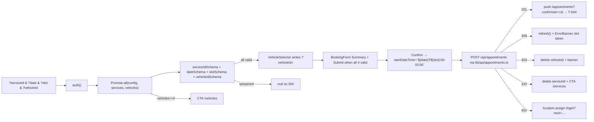

# Design: T-043 Crear formulario de reserva

## Technical Approach

RSC server-direct `listVehiclesByCustomer(db, session.user.id)` in `page.tsx:99` `Promise.all` (D1, no HTTP hop, INV-03/INV-08 via `vehiculo.ts:20-30`) + `VehicleSelector` compound mirroring `ServiceSelector.tsx:1-134` (`createContext`/`use`/`useSearchParams`/`vehicleIdSchema`/`router.push({scroll:false})`) + `BookingForm` posting JSON `POST /api/appointments` via `lib/api/appointments.ts` (mirrors `lib/api/vehicles.ts:42-49` + `lib/http/errors.ts:10-42`). BA TZ hardcoded `-03:00` (Law 26.474, no DST) satisfies `route.ts:27` regex, server converts to UTC `TIMESTAMPTZ`. All 4 selections URL-canonical. No new API; reuses `appointmentService.ts:69-152` `REPEATABLE READ` + `EXCLUDE gist`.

## Architecture Decisions

| Decision | Options | Tradeoff | Choice |
|----------|---------|----------|--------|
| Vehicle fetch location | A server-direct RSC vs B client SWR vs C `fetch("/api/customers/{id}/vehicles")` | A: no waterfall, INV-03 from session. B: credentials/no-store/hydration mismatch. C: hop + leak | **A** |
| Vehicle UI primitive | C1 radio card grid vs C2 select vs C3 RSC `<a>` list | C1 scannable, mirrors siblings; C2 hides scan; C3 loses scroll:false | **C1** |
| Submit transport | D1 fetch JSON vs D2 HTML form vs D3 Server Action | D1 keeps `req.json()` truth; D2 breaks schema; D3 forks envelope | **D1** |
| Pending gate | P1 `useTransition` vs P2 `useState isPending` + try/finally | P1 pending only in transition, can hide errors; P2 explicit, idempotent | **P2** — RESOLVED Q1 |
| 401 redirect | Q1 `location.assign("/login?next="+...)` vs Q2 `redirect()` throw | Q1 imperative, no round-trip, preserves next; Q2 needs server throw | **Q1** — RESOLVED Q2 |
| Empty vehicles | E1 `<Link href="/vehicles">` vs E2 inline form | E1 mirrors T-040 CTA, single owner; E2 scatters mutation | **E1** — RESOLVED Q3 |
| TZ reconstruction | T1 `-03:00` hardcoded vs T2 `Intl` delta vs T3 server computes | T1 simple, fixed since 2009; T2 DST-robust; T3 extra hop | **T1 + TODO(DST) + Intl assert** |
| Compound shape | K1 parallel ServiceSelector vs K2 useState | K1 URL-canonical, back/share lossless; K2 breaks canonical | **K1** |
| Error visibility | B1 inline ErrorBanner vs B2 dialog vs B3 toast | B1 matches siblings, no deps; B2/B3 add complexity | **B1** |
| Force-dynamic | F1 `force-dynamic revalidate=0` vs F2 revalidate=N | F1 matches T-041/T-042 freshness; F2 stale auth/capacity | **F1** |

## Data Flow



Siblings via `new URLSearchParams(searchParams.toString())` (mirrors `AvailabilitySlots.tsx:155`).

## File Changes

| File | Action | Description | LOC |
|------|--------|-------------|-----|
| `src/app/(customer)/appointments/new/page.tsx` | Modify | +`listVehiclesByCustomer` in Promise.all, thread `VehicleDTOJson[]`, compose VehicleSelector + BookingForm | +35 |
| `src/app/(customer)/appointments/new/_components/VehicleSelector.tsx` | Create | Compound List/Card/SelectedBanner/Clear/Empty (mirrors ServiceSelector) | ~105 |
| `src/app/(customer)/appointments/new/_components/BookingForm.tsx` | Create | Compound Summary/Submit/ErrorBanner, `isPending` gate, `409/403/422/401` mapping | ~85 |
| `src/app/(customer)/appointments/new/_components/VehicleCard.tsx` | Create | Radio card `brand model (year) — plate` | ~30 |
| `src/app/(customer)/appointments/new/_components/SummaryCard.tsx` | Create | 4-row summary (foldable into BookingForm) | ~30 |
| `src/app/(customer)/appointments/new/appointments.module.css` | Modify | +.vehicleList/.vehicleCard/.vehicleSelected/.summary/.submit/.errorBanner | +50 |
| `src/lib/api/appointments.ts` | Create | POST helper `credentials:include` + `isErrorBody` (mirrors vehicles.ts) | ~30 |
| `src/lib/validators/vehicleId.ts` | Create | `vehicleIdSchema = z.string().uuid()` + `isOwner` | ~12 |
| `tests/e2e/t043-booking-form.spec.ts` | Create | Playwright full chain (excluded from vitest/tsconfig per T-042) | ~50 |

**Total ~430 prod + ~140 test = ~570 >400 → feature-branch-chain.**

PR1 VehicleSelector + wiring + empty CTA + tests: ~290. PR2 BookingForm + helper + Summary + errors + pending + tests: ~280.

## Interfaces / Contracts

```ts
type SearchParams = { serviceId?: string; date?: string; slot?: string; vehicleId?: string };
const vehicleIdSchema = z.string().uuid();
function isOwner(v: VehicleDTOJson, userId: string): boolean { return v.customerId === userId; }

type VehicleSelectorProps = {
  vehicles: VehicleDTOJson[]; userId: string;
  serviceId: string | null; date: string | null; slot: string | null;
  children: React.ReactNode;
};
type BookingFormProps = {
  serviceId: string; date: string; slot: string; vehicleId: string;
  serviceName: string; vehicleLabel: string;
  onSuccessRedirectTo: (id: string) => string; children: React.ReactNode;
};
type CreateAppointmentInput = { vehicleId: string; serviceId: string; startDateTime: string };
async function submitBooking(i: CreateAppointmentInput): Promise<TurnoDTOJson>;
// POST /api/appointments {vehicleId, serviceId, startDateTime} route.ts:30-91
// 201 / 409 APPOINTMENT_NOT_AVAILABLE / 403 FORBIDDEN / 422 INVALID_SERVICE / 401 UNAUTHORIZED / 400 VALIDATION_ERROR
```

Reuse: DateSelector/AvailabilitySlots, slot/date/serviceId schemas, `appointmentService.ts:69-152` atomic, `lib/http/errors.ts` envelope.

## Testing Strategy

| Layer | What to Test | Approach |
|-------|-------------|----------|
| Unit | helper envelope 201/409/403/422/401, vehicleIdSchema, TZ `-03:00` + Intl assert | Vitest |
| Compound jsdom | VehicleSelector select/clear/tampered/empty/banner; BookingForm gate/409+refresh/403 clear/422 clear/401 redirect/idempotent | Vitest + RTL + userEvent |
| RSC integration | page wiring, 0-vehicles CTA, auth redirect, INV-08 no leak | page.test.tsx |
| E2E | deep-link → Confirm → /appointments?confirmed= | Playwright (excluded) |

## Threat Matrix

N/A — pure RSC + `fetch` + `router.push`. No shell/subprocess/VCS/PR/executable/process integration.

## Migration / Rollout

No migration. Additive branch; T-040/041/042 untouched; `route.ts` unchanged. Rollback `git revert` deletes compounds + helper + CSS + restores `page.tsx:31-261`.

## Open Questions (resolved in this design)

- [x] Submit gate: `useState isPending` + try/finally; explicit, idempotent (`disabled`+`aria-busy`). No `useTransition`.
- [x] 401: `window.location.assign("/login?next="+encodeURIComponent(pathname+search))` — imperative, deterministic.
- [x] Empty vehicles: `<Link href="/vehicles">` — mirrors T-040, `data-testid="booking-empty-vehicles"`.

## Reviewer Focus

1. Sibling preservation: all 4 params survive `router.push` via `URLSearchParams` + `{scroll:false}`.
2. INV-08: only `VehicleDTOJson` primitives cross; no `marca`/`patente`/`cliente_id`/`fecha*`.
3. INV-06: `${date}T${slot}:00-03:00` passes `route.ts:27` regex; server UTC; `Intl` test + `TODO(DST)`.
4. Error envelope: `lib/api/appointments.ts` mirrors `vehicles.ts` + `errors.ts`; 409→refresh, 403→delete vehicleId, 422→delete serviceId, 401→assign.
5. Idempotency: `isPending` + `disabled`+`aria-busy`; server `REPEATABLE READ` + `EXCLUDE gist` guards.
6. Chain discipline: PR1 no submit wiring (Confirm stub disabled); PR2 wires submit.
